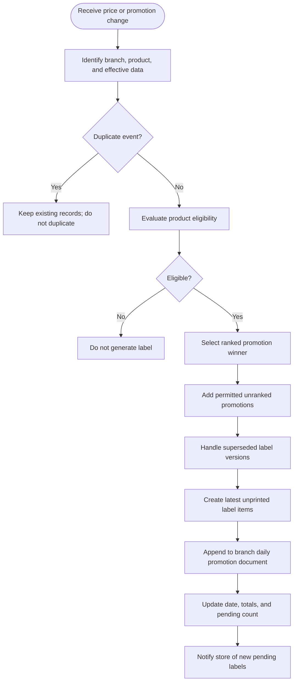
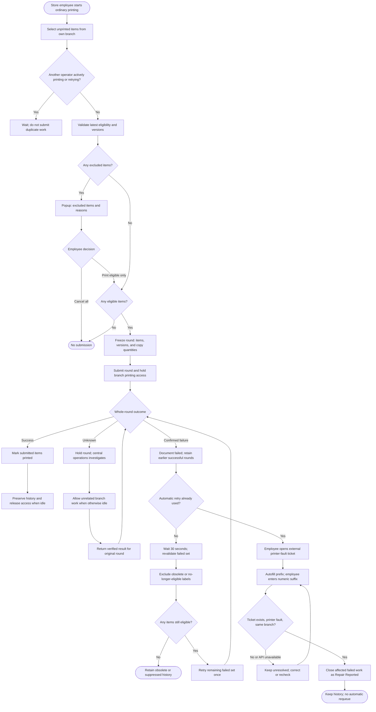
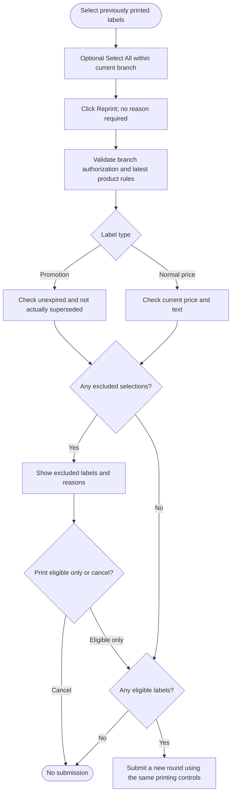
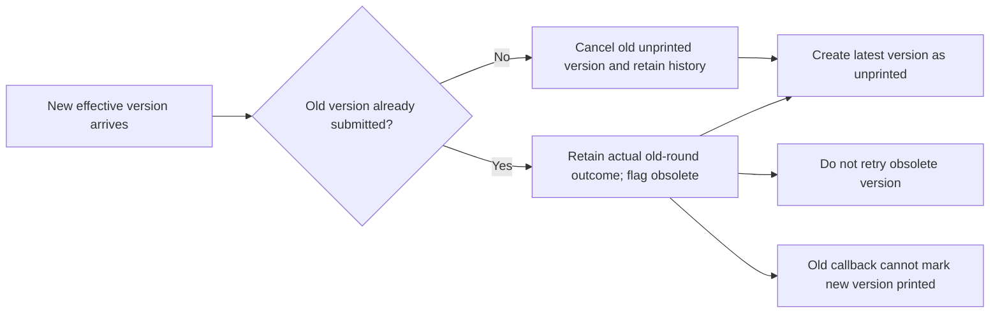

# Workflow Diagrams

These Mermaid diagrams describe the proposed workflows for the pre-development requirements baseline. They support business review and development handoff.

## 1. Label generation and daily documents

Ranked selection uses approved rank, longer total duration, then lower price. A complete tie produces one ranked label. Unranked promotion labels may coexist. Promotion-end events can generate the effective normal-price label after selection and eligibility checks.

## 2. Printing and recovery

Unknown outcomes do not consume a new retry budget merely through investigation. A retry never includes later arrivals or successful earlier rounds. If a round contains obsolete items and exhausted failures, ticket closure applies to the remaining failures independently of obsolete history.

## 3. Reprinting

Reprinting never reopens ticket-closed failed work. A future-effective promotion does not replace today's valid label before its effective time. Permitted coexisting promotion labels do not supersede one another simply because one arrived later.

## 4. Version changes during printing

## Text fallback

Receive event → evaluate eligibility and promotions → append latest items to the daily document → notify → select and validate → confirm exclusions → submit a fixed round → success, central reconciliation, or one retry → ticket closure if retry fails. Earlier successful rounds remain unchanged throughout.

Related specification: [Requirements](requirement.md). Detailed acceptance expectations: [Functional Requirements](functional-request.md).

